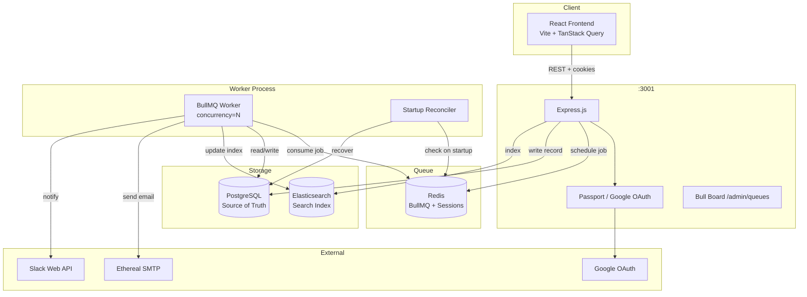
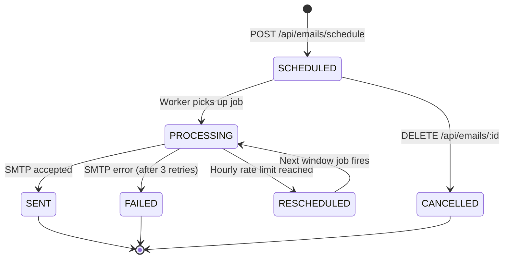
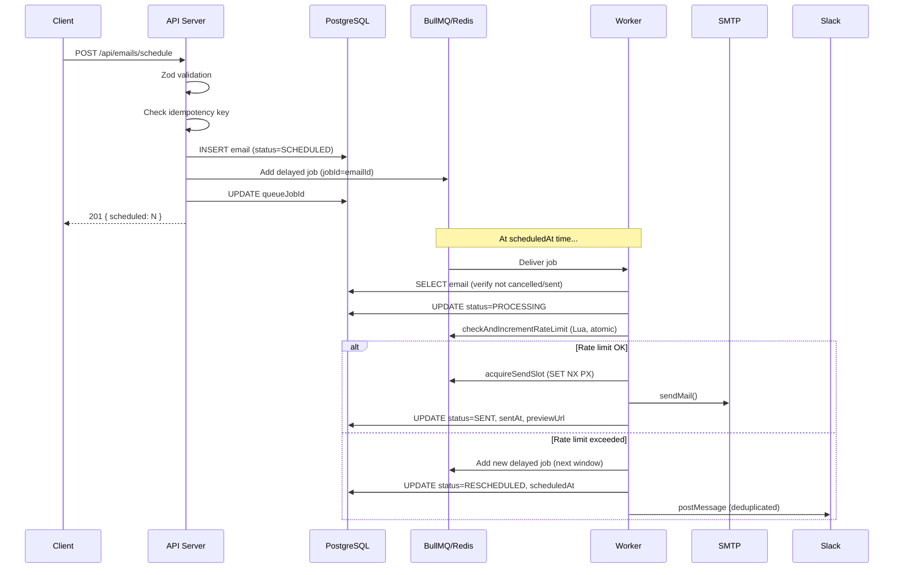

# ReachInbox Email Scheduler

A production-grade full-stack email scheduling platform built with Node.js, TypeScript, BullMQ, PostgreSQL, Redis, and Elasticsearch.

---

## Architecture



---

## Email Lifecycle



---

## Scheduling Flow



---

## Technology Stack

| Layer | Technology |
|---|---|
| Runtime | Node.js 20 |
| Language | TypeScript 5 (ES2022) |
| HTTP | Express.js 4 |
| ORM | Prisma 5 |
| Database | PostgreSQL 16 |
| Queue | BullMQ 5 |
| Cache / Coordination | Redis 7 (IORedis) |
| Search | Elasticsearch 8 |
| Email | Nodemailer + Ethereal SMTP |
| Auth | Passport.js + Google OAuth 2.0 |
| Encryption | AES-256-GCM (Node crypto) |
| Queue Dashboard | Bull Board |
| Frontend | React 18, Vite, Tailwind CSS |
| Data Fetching | TanStack Query v5 |
| Forms | React Hook Form + Zod |
| Testing | Jest + ts-jest |
| Infrastructure | Docker Compose |

---

## Project Structure

```
reachinbox-scheduler/
├── apps/
│   ├── backend/
│   │   ├── src/
│   │   │   ├── config/        # env, database, redis
│   │   │   ├── controllers/   # thin HTTP handlers
│   │   │   ├── services/      # business logic
│   │   │   ├── routes/        # Express router
│   │   │   ├── middleware/     # auth, error handler
│   │   │   ├── workers/       # BullMQ processor
│   │   │   ├── queues/        # Queue + job helpers
│   │   │   ├── schedulers/    # Startup reconciler
│   │   │   ├── integrations/  # Google OAuth strategy
│   │   │   ├── repositories/  # DB query functions
│   │   │   ├── utils/         # logger, encryption, apiResponse
│   │   │   ├── types/         # shared TypeScript types
│   │   │   ├── __tests__/     # Jest test suites
│   │   │   ├── app.ts         # Express app setup
│   │   │   ├── server.ts      # API server entry point
│   │   │   └── worker.ts      # Worker entry point
│   │   └── prisma/
│   │       ├── schema.prisma
│   │       └── migrations/
│   └── frontend/
│       └── src/
│           ├── components/    # StatusBadge, shared UI
│           ├── pages/         # Login, Scheduled, Sent, Compose, Settings
│           ├── layouts/       # DashboardLayout
│           ├── hooks/
│           ├── services/      # api.ts — typed fetch wrappers
│           ├── context/       # AuthContext
│           └── types/
├── docker-compose.yml
├── .env.example
└── README.md
```

---

## Prerequisites

- Node.js 20+
- npm 10+
- Docker and Docker Compose

---

## Installation

```bash
git clone <repo>
cd reachinbox-scheduler
npm install
```

---

## Environment Setup

```bash
cp .env.example .env
```

Open `.env` and fill in:

- `GOOGLE_CLIENT_ID` / `GOOGLE_CLIENT_SECRET` — from [Google Cloud Console](https://console.cloud.google.com)
- `ENCRYPTION_KEY` — exactly 32 characters, any random string
- `SESSION_SECRET` — at least 16 characters, any random string

Everything else has sensible defaults for local development.

---

## Docker Setup

Start PostgreSQL, Redis, and Elasticsearch:

```bash
npm run docker:up
```

Verify all three are healthy:

```bash
docker-compose ps
```

Stop infrastructure:

```bash
npm run docker:down
```

---

## Database Migrations

```bash
cd apps/backend
npx prisma migrate dev        # Apply migrations and regenerate client
npx prisma generate           # Regenerate client only (after schema changes)
npx prisma studio             # Open visual database browser
```

---

## Running the Application

You need three terminal windows.

Terminal 1 — API server:

```bash
npm run dev:backend
```

Terminal 2 — Worker process:

```bash
npm run dev:worker
```

Terminal 3 — Frontend:

```bash
npm run dev:frontend
```

Open `http://localhost:5173`.

---

## Google OAuth Setup

1. Go to [Google Cloud Console](https://console.cloud.google.com)
2. Create a project → APIs & Services → Credentials
3. Create OAuth 2.0 Client ID (Web application)
4. Add `http://localhost:3001/auth/google/callback` as an authorised redirect URI
5. Copy the client ID and secret into `.env`

---

## Slack OAuth Setup

1. Go to [api.slack.com/apps](https://api.slack.com/apps) → Create New App
2. OAuth & Permissions → Add redirect URL: `http://localhost:3001/api/slack/callback`
3. Add Bot Token Scopes: `chat:write`, `channels:read`
4. Copy Client ID and Secret into `.env`
5. In the dashboard Settings page, click Connect Slack

---

## Ethereal SMTP

Ethereal is a fake SMTP service for testing. On first startup, the worker automatically creates a test account and prints the credentials:

```
Add these to your .env to reuse this account across restarts:
  ETHEREAL_USER=abc@ethereal.email
  ETHEREAL_PASS=xxxxx
```

Add them to `.env` so the same inbox is reused across restarts. All sent emails are visible at [ethereal.email](https://ethereal.email).

---

## Elasticsearch

The index is created automatically on startup if it does not exist. If Elasticsearch is down, the system continues to function — emails are stored in PostgreSQL and indexed when ES recovers.

To verify indexing:

```bash
curl http://localhost:9200/emails/_count
curl "http://localhost:9200/emails/_search?q=subject:hello&pretty"
```

---

## Bull Board

Real-time queue dashboard at `http://localhost:3001/admin/queues`.

Credentials are set by `BULL_BOARD_USERNAME` and `BULL_BOARD_PASSWORD` in `.env`.

---

## API Reference

### Authentication

| Method | Path | Description |
|---|---|---|
| GET | /auth/google | Redirect to Google login |
| GET | /auth/google/callback | OAuth callback |
| POST | /auth/logout | End session |
| GET | /api/auth/me | Current user |

### Emails

| Method | Path | Description |
|---|---|---|
| POST | /api/emails/schedule | Schedule a batch |
| GET | /api/emails/scheduled | List scheduled |
| GET | /api/emails/sent | List sent |
| GET | /api/emails | List all |
| GET | /api/emails/:id | Get one |
| DELETE | /api/emails/:id | Cancel |
| GET | /api/emails/search?q= | Elasticsearch search |
| GET | /api/emails/stats | Dashboard counts |

### Senders

| Method | Path | Description |
|---|---|---|
| GET | /api/senders | List senders |
| POST | /api/senders | Create sender |
| PUT | /api/senders/:id | Update sender |
| DELETE | /api/senders/:id | Delete sender |

### Slack

| Method | Path | Description |
|---|---|---|
| GET | /api/slack/connect | Start OAuth flow |
| GET | /api/slack/callback | OAuth callback |
| DELETE | /api/slack/disconnect | Disconnect |
| GET | /api/slack/status | Connection status |

### File Upload

| Method | Path | Description |
|---|---|---|
| POST | /api/upload/recipients | Parse CSV/text |

---

## Scheduling Mechanism

Emails are scheduled using **BullMQ delayed jobs** backed by Redis.

When a request arrives, the email is first written to PostgreSQL (status `SCHEDULED`), then a delayed BullMQ job is added with `delay = scheduledAt - now`. The worker picks it up at the right time.

BullMQ uses a Redis sorted set to hold delayed jobs. The score is the Unix timestamp at which the job should fire. A BullMQ internal timer moves jobs from the delayed set into the active queue when their time arrives.

**Why not cron?** Cron is stateless — if the process restarts, you lose track of what has been scheduled. BullMQ persists state in Redis and survives restarts.

---

## Restart Recovery

On every worker startup, `reconcilePendingJobs()` runs:

1. All `PROCESSING` emails are marked `FAILED` — they were in-flight when the worker crashed and their delivery status is unknown.
2. All `SCHEDULED`/`RESCHEDULED` emails with `scheduledAt > now` are checked.
3. For each, `emailQueue.getJob(jobId)` checks if the BullMQ job still exists in Redis.
4. Missing jobs are re-enqueued with the same `jobId` — BullMQ deduplicates by `jobId`, so this is safe even if the job somehow still exists.

**Known limitation — SMTP ambiguity:** If the worker crashes after the SMTP server accepts a message but before PostgreSQL records `SENT`, the email may have been delivered but the database will not reflect this. On restart, the email is not automatically retried (it is in `PROCESSING`, which becomes `FAILED`). An operator should check the Ethereal inbox to confirm delivery. This is a fundamental limitation of non-transactional SMTP — perfect exactly-once delivery would require end-to-end delivery receipts that most SMTP providers do not support.

---

## Idempotency

Every scheduled email has a unique `idempotencyKey`. On the API side:

- If no key is provided, one is generated from `userId + senderId + recipient + scheduledAt`.
- Before creating a new record, the key is checked. If it exists, the email is skipped (`result.skipped++`).
- BullMQ jobs use `emailId` as the `jobId`, which deduplicates at the queue level too.

This means the schedule endpoint is safe to retry on network failure.

---

## Concurrency

`WORKER_CONCURRENCY=5` means BullMQ calls the processor up to 5 times before waiting for one to resolve.

This is **async concurrency**, not CPU parallelism. Node.js is single-threaded — 5 concurrent jobs share the same thread via the event loop, interleaved at I/O await points (database queries, SMTP calls). This is efficient for I/O-bound work.

**Important implication:** With 5 concurrent jobs potentially targeting the same sender, in-memory checks are not safe. All distributed coordination uses Redis:

- Rate limiting: Lua script (atomic `GET + INCR + EXPIRE`)
- Send delay: `SET NX PX` (atomic set-if-not-exists with expiry)

`Promise.all` provides async concurrency within a single process — it does not provide distributed coordination across multiple worker instances.

---

## Minimum Send Delay

Configured via `MIN_EMAIL_DELAY_MS` (default: 2000ms) or per-sender via `minimumSendDelay`.

After a successful send from a sender, a Redis key `send_delay:{senderId}` is set with a TTL equal to the delay. Any worker attempting to send from the same sender during that window finds the key present and re-throws, causing BullMQ to retry with backoff.

**Algorithm:** Redis `SET key 1 PX <delayMs> NX`

- `NX`: only sets if the key does not exist — atomic, no race condition
- `PX`: millisecond expiry — the key automatically disappears after the delay

---

## Distributed Rate Limiting

Per-sender hourly limits are enforced with a Redis Lua script:

```lua
local current = tonumber(redis.call('GET', key) or '0')
if current >= limit then
  return { 0, current, resetsAt }  -- blocked
end
local newCount = redis.call('INCR', key)
if newCount == 1 then
  redis.call('EXPIRE', key, 3600)  -- start the hour window
end
return { 1, newCount, resetsAt }   -- allowed
```

The Lua script runs atomically inside Redis — no other command can execute between the `GET` and the `INCR`. This eliminates the TOCTOU race condition regardless of how many worker processes are running.

Key format: `rate_limit:{senderId}:{hourBucket}` where `hourBucket = floor(now / 3600000)`.

---

## Slack Notifications

When a sender hits its hourly limit:

1. The worker calls `notifySlackRateLimitReached()`
2. A deduplication key `slack_notified:{senderId}:{hourBucket}` is checked
3. If already notified this hour, skip (no duplicate floods)
4. Otherwise, call `chat.postMessage` via Slack Web API
5. If Slack is disconnected or errors, log and continue — email processing is never blocked

---

## Trade-offs and Known Limitations

**SMTP exactly-once:** As described in Restart Recovery, a crash in the narrow window between SMTP acceptance and database update creates an ambiguous state. This is an inherent limitation of SMTP.

**Clock-hour rate limits vs. rolling windows:** Limits reset at the top of each clock hour rather than on a rolling 60-minute window. Rolling windows are more accurate but significantly more complex to implement atomically in Redis. Clock-hour buckets are the right trade-off for a first production implementation.

**Single queue:** All senders share one BullMQ queue. With many senders at different rate limits, a fairer design would use per-sender queues or priority queues. This is a known scaling limitation.

**Elasticsearch sync:** Elasticsearch is updated asynchronously and can lag behind PostgreSQL. The `/api/emails/search` endpoint uses ES. The list endpoints (`/api/emails/scheduled`, `/api/emails/sent`) read directly from PostgreSQL and are always accurate.

**Session store:** Sessions are stored in Redis. If Redis is unavailable, users cannot log in. A database-backed session store would be more resilient but slower.

---

## Running Tests

```bash
cd apps/backend
npm test
```

Test suites:

- `emailScheduler.test.ts` — validation, idempotency, scheduling
- `concurrency.test.ts` — rate limiting and send delay under concurrent load
- `reconciler.test.ts` — startup recovery logic
- `worker.test.ts` — job processor status transitions
- `encryption.test.ts` — AES-256-GCM round-trip and tamper detection

---

## Demonstration Scenarios

### Scenario 1 — Normal scheduling

1. Log in with Google
2. Settings → Add a sender
3. Compose → Upload a CSV → Set a time 2 minutes from now → Schedule
4. Watch Bull Board — job moves from Delayed → Active → Completed
5. Sent tab — click the Ethereal preview URL

### Scenario 2 — Restart recovery

1. Schedule emails 10 minutes in the future
2. `Ctrl+C` the worker
3. Restart the worker (`npm run dev:worker`)
4. Worker logs: `Reconciliation complete — N already queued`
5. Emails are sent at the correct time

### Scenario 3 — Rate limiting

1. Create a sender with `hourlyLimit: 3`
2. Schedule 5 emails 1 minute from now
3. First 3 are sent, next 2 are rescheduled
4. Slack receives one notification
5. Next hour, the 2 rescheduled emails are sent

### Scenario 4 — Multiple senders

1. Create two senders with different hourly limits
2. Schedule emails for both simultaneously
3. Each sender's limit is tracked independently in Redis

### Scenario 5 — Concurrency

1. Set `WORKER_CONCURRENCY=10` in `.env`
2. Schedule 100 emails
3. Bull Board shows up to 10 Active at once
4. Rate limits are respected — no over-sending

### Scenario 6 — Elasticsearch search

1. After sending some emails, use the search bar in the dashboard
2. Or directly: `GET /api/emails/search?q=hello&status=SENT`
